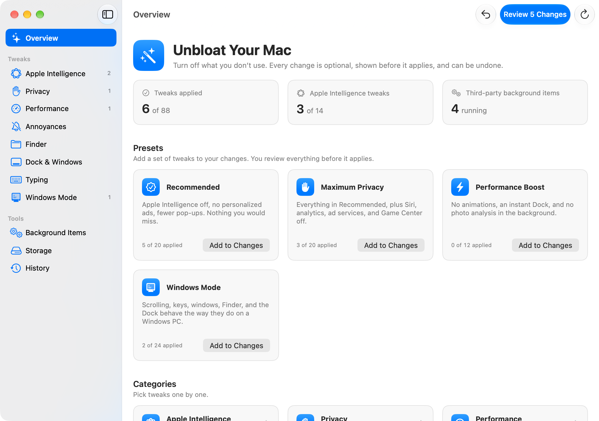
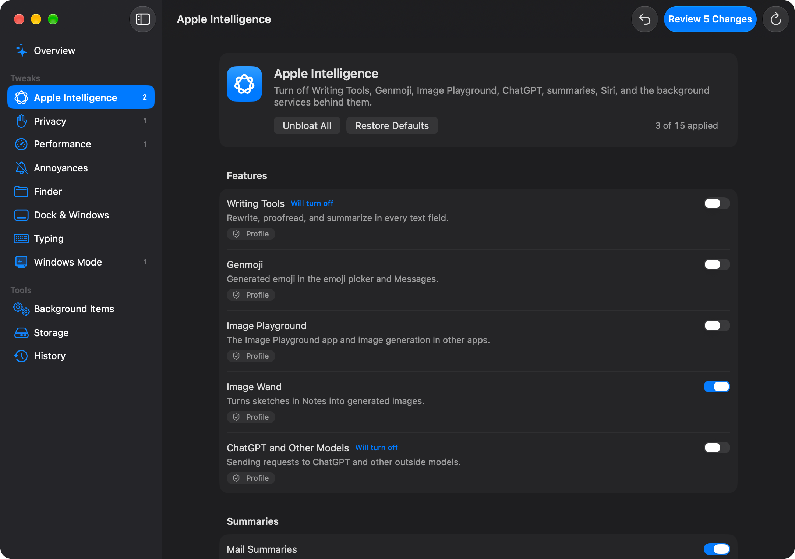
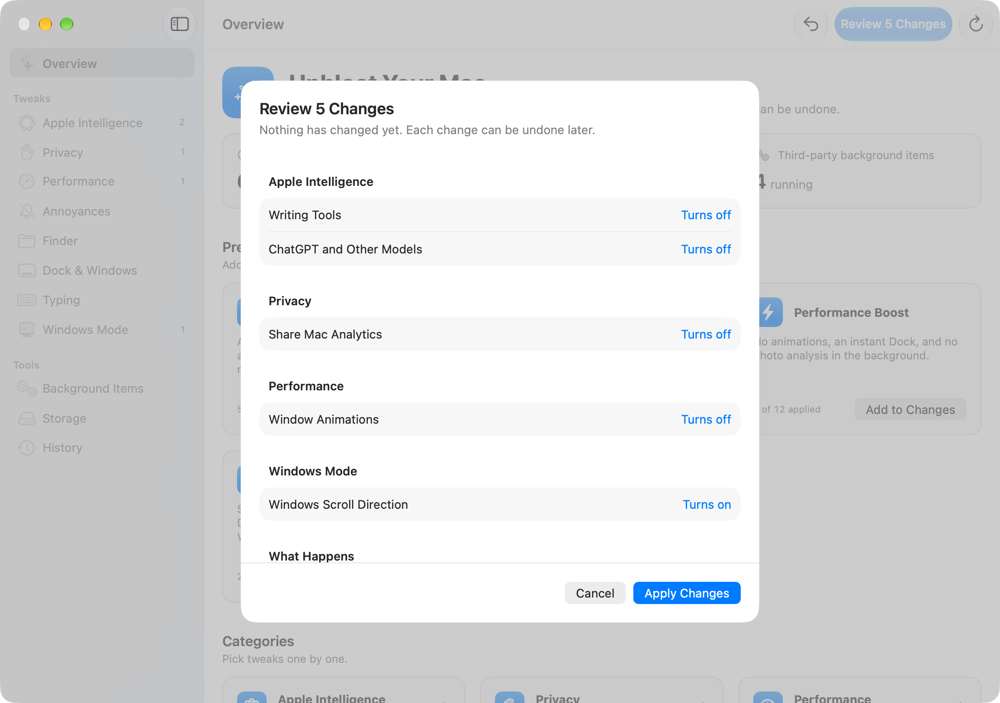

# UnbloatMyMac

A native Mac app that turns off what you don't use: Apple Intelligence, telemetry, slow animations, pop-ups, and background updaters. It can also make your Mac behave more like a Windows PC.

Every tweak is optional, shown to you before it applies, and can be undone.



## What it can change

| Category | Examples |
| --- | --- |
| **Apple Intelligence** | Writing Tools, Genmoji, Image Playground, Image Wand, ChatGPT, Mail, Notes and Safari summaries, inline predictions, Siri, and the background model services |
| **Privacy** | Mac Analytics, Siri and dictation sharing, personalized ads, ad services, Look Up and Spotlight web suggestions, Game Center, Screen Time tracking |
| **Performance** | Window, Quick Look and Finder animations, instant Dock reveal, faster Mission Control, photo analysis, App Nap, Power Nap, Spotlight indexing |
| **Annoyances** | Click wallpaper to show desktop, desktop widgets, crash report pop-ups, Time Machine disk prompt, Photos opening for iPhone, screenshot shadows and thumbnail |
| **Finder** | File extensions, hidden files, path and status bars, folders first, search this folder, no `.DS_Store` on network and USB drives, Library folder |
| **Dock & Windows** | Recent apps, bouncing icons, only open apps, scale effect, Spaces order, tiling without gaps |
| **Typing** | Autocorrect, automatic capitals, smart quotes and dashes, accent menu, fast key repeat |
| **Windows Mode** | Windows scroll direction, standard F-keys, Home and End keys, double-click to maximize, snap to edges, scroll bars always visible, Dock as a taskbar, drives on the desktop |

The **Background Items** page stops third-party updaters and helpers. **Storage** clears caches, Xcode data, old installers, and Time Machine local snapshots. **History** has **Undo Everything**.

Presets: **Recommended**, **Maximum Privacy**, **Performance Boost**, and **Windows Mode**.

<p>
  
  
</p>

## How changes work

- **Review first.** Switches only stage changes. **Review Changes** lists every change and what will happen: a password prompt, a profile to approve, a Dock or Finder restart, or a log out.
- **Exact undo.** Before changing a setting, the app saves its old value in `~/Library/Application Support/UnbloatMyMac/journal.json`. Undo puts back that value, not a guess.
- **Settings** are written with the same mechanism as `defaults write`.
- **Background services** are stopped with `launchctl disable` in your user session. They take full effect after you log out. System Integrity Protection stays on.
- **Apple Intelligence features** are turned off with a configuration profile (`com.apple.applicationaccess` restrictions). macOS asks you to approve it in System Settings → General → Device Management. Removing the profile turns the features back on.
- **Commands that need admin rights**, like Power Nap, Mac Analytics, and Spotlight indexing, run together under one password prompt.
- **Storage cleanup** moves files to the Trash. Simulators and local snapshots are deleted at once, and the app says so before.

Tweaks marked **Advanced** stop system services and can break features, such as Shortcuts suggestions or Photos search. Each one says what you lose. They stay hidden unless you turn them on in Settings.

## Requirements

macOS 26 or later. Built and tested on macOS 27.

## Install

Download the latest zip from [Releases](../../releases), unzip it, and move **UnbloatMyMac** to Applications.

## Build from source

```bash
git clone https://github.com/matguitarist/UnbloatMyMac.git
cd UnbloatMyMac
./build.sh --open        # builds, signs, installs to ~/Applications, opens
```

It needs Swift 6.2 or later (Xcode 26 or the matching command line tools). There is no Xcode project; the app is a Swift package.

```bash
swift test --scratch-path ~/Library/Developer/UnbloatMyMac/test-build   # engine unit tests
tools/selftest.sh                                                       # in-app checks on a pretend Mac
tools/snap.sh                                                           # light and dark screenshots of every page
```

Tests, snapshots, and the self-test run on a pretend Mac (`MockBackend`) and never change your system.

## Adding a tweak

Tweaks live in [`Sources/UnbloatMyMacKit/Catalog.swift`](Sources/UnbloatMyMacKit/Catalog.swift). A tweak is a list of actions:

- a `defaults` value
- a launch agent to disable
- a profile restriction
- a command with its revert and check
- a file

Two tweaks must never write the same key; a unit test checks this.

## Thanks

Inspired by [RemoveMacAI](https://github.com/omlahore/RemoveMacAI).

## License

MIT. See [LICENSE](LICENSE). Use it at your own risk: it changes system settings.
